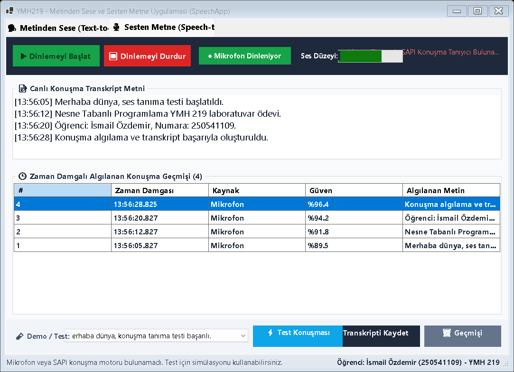

# YMH219 - Speech-to-Text ve Text-to-Speech Masaüstü Uygulaması (SpeechApp)


Bu proje, **Nesne Tabanlı Programlama (YMH 219)** dersi laboratuvar / ek uygulama ödevleri kapsamında geliştirilmiş nesne yönelimli bir **Çift Yönlü Konuşma ve Ses İşleme (Speech-to-Text / Text-to-Speech)** masaüstü uygulamasıdır.

Uygulama; Windows Forms ve .NET `System.Speech` (`System.Speech.Synthesis` ve `System.Speech.Recognition`) kütüphaneleri kullanılarak metinlerin yapay ses ile seslendirilmesini, mikrofondan alınan konuşmaların yazıya dökülmesini, ses hızı/düzeyi ayarlarını, canlı kelime takibini ve konuşma geçmişinin `.txt` / `.wav` olarak dışa aktarılmasını sağlar.

---

## 📸 Ekran Görüntüleri

| 🗣️ Metinden Sese (Text-to-Speech) & Canlı Kelime Vurgulama | 🎙️ Sesten Metne (Speech-to-Text) & Zaman Damgalı Geçmiş |
| :---: | :---: |
|  |  |

---

## 🛠️ Kullanılan Teknolojiler ve Kütüphaneler

- **Programlama Dili:** C# 12
- **Çalışma Zamanı (Runtime):** .NET 8.0 Windows Desktop (`net8.0-windows`)
- **Arayüz Kütüphanesi:** Windows Forms (WinForms)
- **Konuşma Kütüphanesi:** `System.Speech` 8.0.0 (Microsoft resmi konuşma kütüphanesi)
  - `System.Speech.Synthesis`: Metin okuma, ses profilleri, duraklatma/devam ettirme, WAV çıktısı.
  - `System.Speech.Recognition`: Mikrofon dinleme, dilbilgisi kuralları (`DictationGrammar`), güven puanı ve ses seviyesi (VU).
- **Dosya I/O:** `System.IO.StreamWriter` (UTF-8 formatında yapılandırılmış transkript ve metin dışa aktarımı)

---

## 🚀 Kurulum ve Çalıştırma Adımları

### Gereksinimler
- [.NET 8.0 SDK](https://dotnet.microsoft.com/download/dotnet/8.0) veya üzeri
- Windows 10 / 11 işletim sistemi
- Mikrofon (Konuşma tanıma testi için) ve Hoparlör / Kulaklık (Metin okuma için)

### 1. Depoyu Klonlama
```bash
git clone https://github.com/ismailozdemir27/YMH219-SpeechApp.git
cd YMH219-SpeechApp
```

### 2. Projeyi Derleme
```bash
dotnet build
```

### 3. Uygulamayı Başlatma
```bash
dotnet run
```
*Veya `SpeechApp.csproj` dosyasını Visual Studio 2022 ile açıp `F5` tuşu ile başlatabilirsiniz.*

---

## ✨ Uygulamanın Temel Özellikleri

### 1. 🗣️ Metinden Sese (Text-to-Speech / TTS)
- **Metin Okuma:** `RichTextBox` içine yazılan veya yapıştırılan her türlü metni yapay zeka ses sentezleyicisi ile seslendirir.
- **Oynatma Kontrolleri:**
  - **▶ Oynat (Speak):** Metni baştan veya kaldığı yerden okur.
  - **⏸ Duraklat (Pause):** Seslendirmeyi anında dondurur.
  - **▶ Devam Et (Resume):** Duraklatılan yerden kesintisiz devam eder.
  - **⏹ Durdur (Stop):** Seslendirmeyi tamamen sonlandırır.
  - **🗑️ Temizle (Clear):** Metin alanını sıfırlar.
- **Canlı Kelime Vurgulama (Word Highlighting):** Okuma esnasında `SpeakProgress` olayı ile o an telaffuz edilen kelime sarı renkle canlı olarak işaretlenir.

### 2. 🎙️ Sesten Metne (Speech-to-Text / STT)
- **Mikrofon Dinleme:** ▶ *Dinlemeyi Başlat* ve ⏹ *Dinlemeyi Durdur* butonları ile mikrofonu kontrol eder.
- **Canlı Transkript:** Mikrofondan konuşulan cümleler anlık olarak transkript alanına aktarılır.
- **Zaman Damgalı ve Güven Puanlı Geçmiş Tablosu:**
  - Her algılanan konuşma; sıra numarası, zaman damgası (`HH:mm:ss.fff`), kaynak (`Mikrofon` / `Simülasyon`), güven yüzdesi (`%94.2`) ve algılanan metin ile `DataGridView` üzerinde listelenir.
- **Canlı VU Meter (Ses Seviyesi):** Konuşma esnasında mikrofon giriş seviyesini (`0 - 100`) canlı ProgressBar üzerinde gösterir.
- **Donanım ve Servis Kontrolü:** Mikrofon takılı olmadığında veya sistemde SAPI tanıyıcı motoru bulunmadığında çökme yaşanmaz, kullanıcıya anlaşılır yönlendirme mesajı gösterilir.

---

## 🌟 İsteğe Bağlı / Ek Puan Geliştirmeleri (Tam Puan Kapsamı)

Laboratuvar yönergesindeki ek puan kriterlerinin tümü uygulanmıştır:

1. **Ses Hızı ve Ses Düzeyi Ayarı (Rate & Volume):**
   - Hız kaydırıcısı (`TrackBar`): `-10` (en yavaş) ile `+10` (en hızlı) arasında dinamik kontrol.
   - Ses seviyesi kaydırıcısı: `%0` ile `%100` arasında gerçek zamanlı ses seviyesi kontrolü.
2. **Ses Profili Seçimi (Voice Selection):**
   - Windows üzerinde yüklü tüm ses motorlarını (kadın/erkek, farklı diller) otomatik tarar ve açılır kutuda listeler.
3. **Dönüştürülen Metni Dosyaya Kaydetme (`StreamWriter`):**
   - *"Metni Kaydet (.txt)"* ve *"Transkripti Kaydet (.txt)"* butonları ile UTF-8 formatında yapılandırılmış rapor çıktısı üretir.
4. **WAV Ses Dosyasına Aktarma (`.wav Export`):**
   - Yazılan metni doğrudan `.wav` formatında bir ses dosyası olarak dışa aktarır (`SpeechAudioFormatInfo`).
5. **Laboratuvar Sunumu & Simülasyon Desteği:**
   - Mikrofonu veya Windows SAPI dil paketi olmayan bilgisayarlarda öğretmen veya öğrencinin STT işlevini, transkripti ve log tablosunu tam olarak test edebilmesi için *"🧪 Test Konuşması Simüle Et"* aracı entegre edilmiştir.

---

## 🏛️ Nesne Tabanlı Tasarım ve Proje Mimarisi

```
YMH219-SpeechApp/
├── Enums/
│   ├── SynthesisStatus.cs      # Idle, Speaking, Paused
│   └── RecognitionStatus.cs    # Idle, Listening, Processing, Unavailable
├── Models/
│   ├── VoiceModel.cs           # Name, Culture, Gender, Age, DisplayName
│   └── SpeechLogEntry.cs       # Id, Timestamp, Text, Confidence, Source, Format
├── Services/
│   ├── TextToSpeechService.cs  # SpeechSynthesizer sarmalayıcısı (Hız, Seviye, Oynat/Durdur, WAV)
│   ├── SpeechToTextService.cs  # SpeechRecognitionEngine ve mikrofon yönetimi (Güven puanı, VU, Fallback)
│   └── FileExportService.cs    # StreamWriter tabanlı TXT rapor ve transkript dışa aktarıcısı
├── Forms/
│   ├── MainForm.cs             # Çift sekmeli kullanıcı arayüzü ve olay yönetimi
│   └── MainForm.Designer.cs    # Arayüz bileşenleri ve görsel yerleşim
├── Program.cs                  # Uygulama giriş noktası ve otomatik ekran görüntüsü üreticisi
├── screenshots/                # README ekran görüntüleri
│   ├── tts_panel.png
│   └── stt_panel.png
├── .gitignore                  # Visual Studio / .NET için tam yalıtım
└── SpeechApp.csproj            # .NET 8.0 Windows Forms ve System.Speech proje dosyası
```

---

## ⚠️ Bilinen Sınırlamalar / Bilgilendirme Notları

- **Konuşma Tanıma (STT) Dil Desteği:** Windows `System.Speech.Recognition` altyapısı, sistemde kurulu olan SAPI 5 tanıyıcı dil paketlerini kullanır. Eğer bilgisayarınızda İngilizce veya Türkçe SAPI konuşma tanıyıcı paketi yüklü değilse, uygulama çökmeden kullanıcıyı uyarır ve testlerinizi gerçekleştirebilmeniz için entegre simülasyon modunu devreye sokar.
- **Ses Profilleri:** Okuma esnasında kullanılan sesler (`Microsoft Zira`, `Microsoft David` vb.) kullanıcının Windows işletim sisteminde yüklü olan ses paketlerine bağlı olarak çeşitlilik gösterir.

---

## 👤 Öğrenci Bilgileri

- **Adı - Soyadı:** İsmail Özdemir
- **Öğrenci Numarası:** 250541109
- **Ders:** Nesne Tabanlı Programlama (YMH 219)
- **Dönem:** 2026-2027 Güz
