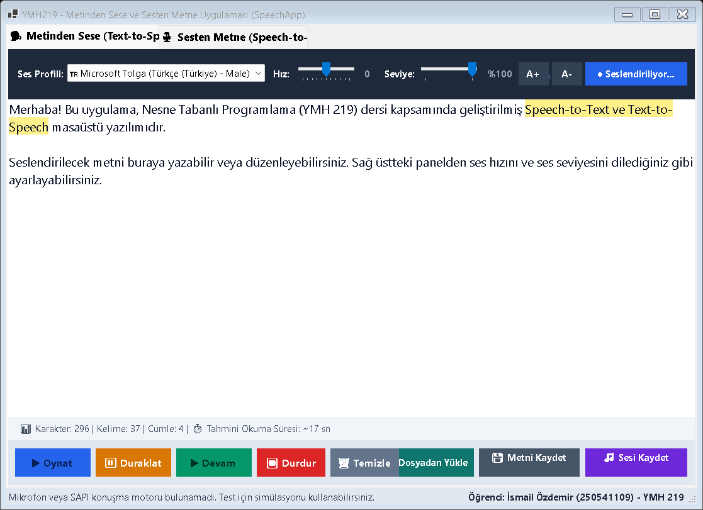

# YMH219 - Speech-to-Text ve Text-to-Speech Masaüstü Uygulaması (SpeechApp)


-red?style=for-the-badge)


Bu proje, **Nesne Tabanlı Programlama (YMH 219)** dersi laboratuvar / ek uygulama ödevleri kapsamında geliştirilmiş nesne yönelimli, çok motorlu bir **Çift Yönlü Konuşma ve Ses İşleme (Speech-to-Text / Text-to-Speech)** masaüstü uygulamasıdır.

Uygulama; Windows Forms, .NET `System.Speech` ve `Windows.Media.SpeechSynthesis` (WinRT OneCore) altyapılarını bir araya getirerek hem **Türkçe (Microsoft Tolga)** hem de **İngilizce (Microsoft Zira vb.)** doğal sesleriyle akıcı metin okuma, mikrofondan konuşma tanıma, sesli komut algılama, canlı ekolayzır animasyonu ve konuşma geçmişini `.txt` / `.wav` olarak dışa aktarma işlevlerini sunar.

---

## 📸 Ekran Görüntüleri

| 🗣️ Metinden Sese (Text-to-Speech) & Türkçe Ses & Canlı Vurgulama | 🎙️ Sesten Metne (Speech-to-Text) & Sesli Komut & Çift Yönlü Entegrasyon |
| :---: | :---: |
|  |  |

---

## 🛠️ Kullanılan Teknolojiler ve Kütüphaneler

- **Programlama Dili:** C# 12
- **Çalışma Zamanı (Runtime):** .NET 8.0 Windows Desktop (`net8.0-windows10.0.19041.0`)
- **Arayüz Kütüphanesi:** Windows Forms (WinForms)
- **Konuşma Motorları:**
  - `Windows.Media.SpeechSynthesis` & `Windows.Media.Playback.MediaPlayer`: Modern Windows OneCore **Türkçe Ses Motoru (Microsoft Tolga - tr-TR)**.
  - `System.Speech.Synthesis`: Klasik SAPI 5 masaüstü ses motoru (Microsoft Zira vb.).
  - `System.Speech.Recognition`: Mikrofon dinleme, serbest dikte (`DictationGrammar`), anahtar kelime dilbilgisi (`Choices`), güven skoru ve ses seviyesi (VU).
- **Dosya I/O:** `System.IO.StreamWriter` ve `System.IO.File` (UTF-8 rapor, dosya yükleme ve WAV çıktıları).

---

## 🚀 Kurulum ve Çalıştırma Adımları

### Gereksinimler
- [.NET 8.0 SDK](https://dotnet.microsoft.com/download/dotnet/8.0) veya üzeri
- Windows 10 / 11 işletim sistemi
- Hoparlör / Kulaklık (Metin okuma için) ve Mikrofon (Konuşma tanıma testi için)

### 1. Depoyu Klonlama
```bash
git clone https://github.com/ismailozdemir27/YMH219-SpeechApp.git
cd YMH219-SpeechApp
```

### 2. Projeyi Derleme
```bash
dotnet build
```

### 3. Uygulamayı Başlatma
```bash
dotnet run
```
*Veya `SpeechApp.csproj` dosyasını Visual Studio 2022 ile açıp `F5` tuşuna basarak çalıştırabilirsiniz.*

---

## ✨ Uygulamanın Temel Özellikleri

### 1. 🗣️ Metinden Sese (Text-to-Speech / TTS)
- **🇹🇷 Doğal Türkçe Okuma:** Windows OneCore **Microsoft Tolga (tr-TR)** ses motoru entegrasyonu ile Türkçe metinleri pürüzsüz ve doğal tonlamayla okur.
- **🌐 Çoklu Dil ve Ses Profilleri:** Sistemdeki tüm Türkçe ve yabancı sesleri otomatik tanır ve açılır menüde listeler.
- **Oynatma Kontrolleri:**
  - **▶ Oynat (Speak):** Metni seslendirir.
  - **⏸ Duraklat (Pause):** Okumayı anında dondurur.
  - **▶ Devam (Resume):** Kaldığı yerden devam eder.
  - **⏹ Durdur (Stop):** Okumayı tamamen durdurur.
  - **🗑️ Temizle (Clear):** Metin alanını temizler.
- **Canlı Kelime Vurgulama (Karaoke):** Okunan kelime `SpeakProgress` olayı ile metin üzerinde anlık olarak sarı renkle işaretlenir.
- **🎵 Hareketli Ses Dalgası (Waveform):** Ses çalarken ritmik olarak dalgalanan görsel ekolayzır çubukları.

### 2. 🎙️ Sesten Metne (Speech-to-Text / STT)
- **Mikrofon Dinleme:** ▶ *Dinlemeyi Başlat* ve ⏹ *Dinlemeyi Durdur* butonları ile mikrofonu kontrol eder.
- **Canlı Transkript:** Algılanan konuşmalar anında zaman damgasıyla transkript metin kutusuna düşer.
- **Zaman Damgalı Geçmiş Tablosu (`DataGridView`):**
  - Sıra No, Zaman Damgası (`HH:mm:ss.fff`), Kaynak (`Mikrofon` / `Simülasyon`), Güven Puanı (`%96.4`) ve Algılanan Cümleyi ayrıntılı listeler.
- **Canlı VU Meter:** Mikrofon ses giriş seviyesini (`0 - 100`) canlı ProgressBar üzerinde görselleştirir.
- **Hata Toleransı ve Çökmeme:** Mikrofon takılı olmadığında veya SAPI dil paketi eksik olduğunda uygulama çökmez, kullanıcıya anlaşılır yönlendirme mesajı sunar.

---

## 🌟 İsteğe Bağlı / Ek Puan Geliştirmeleri (Tam Puan Kapsamı)

1. **🗣️ ⇄ 🎙️ Çift Yönlü Entegrasyon ("Konuşulanı TTS ile Oku"):**
   - STT sekmesinde algılanan konuşma metnini tek tıkla TTS sekmesine aktarır ve yapay sesle anında seslendirir. İki teknolojinin birbirini beslediği entegre bir döngü kurulmuştur.
2. **📂 Metin Dosyası Yükleme & Sürükle-Bırak (Drag & Drop):**
   - Masaüstünden herhangi bir `.txt` dosyasını pencereye sürükleyip bırakarak veya *"📂 Dosyadan Yükle"* butonu ile doğrudan metin alanına aktarabilme.
3. **📊 Canlı Metin İstatistikleri & Tahmini Okuma Süresi:**
   - Metin kutusunun altında anlık karakter, kelime, cümle sayısı ve seçilen ses hızına göre hesaplanan **Tahmini Okuma Süresi (sn)**.
4. **⚡ Sesli Komut Algılama (Voice Commands):**
   - Konuşma esnasında geçen anahtar kelimelerle arayüz kontrolü:
     - *"Temizle"* -> Geçmişi ve transkripti temizler.
     - *"Kaydet"* -> Kaydetme penceresini açar.
     - *"Durdur"* -> Dinlemeyi sonlandırır.
     - *"Oku / Seslendir"* -> Metni TTS'e aktarıp okur.
5. **🔍 Erişilebilirlik - Font Boyutu (A+ / A-):**
   - Metin kutularının yazı boyutunu tek tıkla büyütüp küçültebilme.
6. **Hız ve Ses Düzeyi Kontrolü:**
   - Hız kaydırıcısı (`-10` ile `+10` arası) ve Ses düzeyi (`%0` ile `%100` arası) dinamik ayarı.
7. **Dışa Aktarma:**
   - Metinleri ve konuşma dökümlerini `StreamWriter` ile `.txt` formatında kaydetme.
   - Yazılan metni doğrudan `.wav` ses dosyasına dönüştürme.
8. **Laboratuvar Sunumu & Simülasyon Desteği:**
   - SAPI dil paketi veya mikrofon bulunmayan ortamlarda test yapabilmek için örnek konuşma simülasyonu.

---

## 🏛️ Nesne Tabanlı Tasarım ve Proje Mimarisi

```
YMH219-SpeechApp/
├── Enums/
│   ├── SynthesisStatus.cs      # Idle, Speaking, Paused
│   └── RecognitionStatus.cs    # Idle, Listening, Processing, Unavailable
├── Models/
│   ├── VoiceModel.cs           # Name, Culture, Gender, Engine (SAPI5/OneCore), FlagEmoji
│   └── SpeechLogEntry.cs       # Id, Timestamp, Text, Confidence, Source, Format
├── Services/
│   ├── TextToSpeechService.cs  # Çok motorlu TTS (OneCore Tolga + SAPI Zira, Rate, Volume, WAV)
│   ├── SpeechToTextService.cs  # SpeechRecognitionEngine mikrofon yönetimi (Güven skoru, VU, Fallback)
│   └── FileExportService.cs    # StreamWriter tabanlı TXT rapor ve transkript dışa aktarıcısı
├── Forms/
│   ├── MainForm.cs             # Çift sekmeli arayüz, sesli komutlar, sürükle-bırak, istatistikler
│   └── MainForm.Designer.cs    # Modern UI bileşenleri ve görsel yerleşim
├── Program.cs                  # Giriş noktası ve otomatik ekran görüntüsü üreticisi
├── screenshots/                # README ekran görüntüleri
│   ├── tts_panel.png
│   └── stt_panel.png
├── .gitignore                  # Visual Studio / .NET için tam yalıtım
└── SpeechApp.csproj            # .NET 8.0 Windows 10 SDK ve System.Speech proje dosyası
```

---

## 👤 Öğrenci Bilgileri

- **Adı - Soyadı:** İsmail Özdemir
- **Öğrenci Numarası:** 250541109
- **Ders:** Nesne Tabanlı Programlama (YMH 219)
- **Dönem:** 2026-2027 Güz
